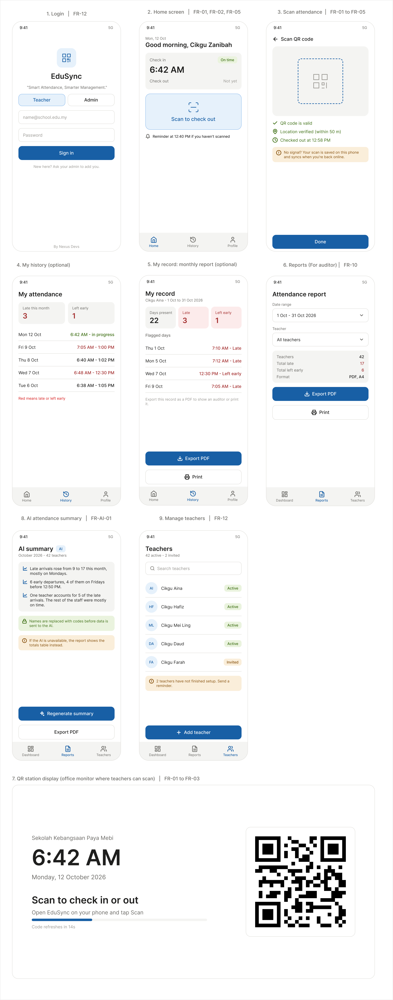

# AI-Powered QR Attendance System for Educators

**Group:** G01_T10 / Nexus Devs
**Lab Group / Demonstrator:** Group 1 - MD. Aminul Islam Rakib
**Deadline:** 16 October 2026

## Overview

An AI-powered attendance system that lets educators take attendance quickly by scanning QR codes, and view attendance records and insights on a dashboard.

## Features (planned)

- QR code scan screen for recording attendance
- Educator dashboard with attendance records and summaries
- AI-assisted features via an external AI API (cost and privacy constraints under research)
- Automated build and checks with GitHub CI/CD

## Team

| Name | Matric No. | TSPi Role |
|------|------------|-----------|
| Wan Adam Danish bin Wan Abit | 103014 | Project Manager |
| Batrisya Qistina binti Jumry | 103516 | System Analyst |
| Nur Damia Amirah binti Meruni | 100316 | AI Integration |
| Qhairunnisa Shahirah binti Zakaria | 106089 | Mobile Architect |
| Abdul Rahim bin Idris | 102368 | Quality Assurance |

## Repository Structure

```
/docs        Meeting minutes, wireframes, research notes
/src         Application source code
/tests       Test files
/.github     CI/CD workflows and issue templates
```

## Getting Started

```bash
git clone https://github.com/d-amirah03/EduSync.git
cd EduSync
# Add install and run instructions once the tech stack is confirmed
```

## Workflow

1. Create or pick an issue (each action item has a GitHub issue).
2. Branch from `main`, e.g. `feature/ui-wireframes`.
3. Open a pull request and get at least one teammate to review.
4. Merge to `main` only when CI passes.

## Action Items (Meeting 01)

| No | Action item | Owner | Due |
|----|-------------|-------|-----|
| 1 | Set up GitHub Repository | Nur Damia | 9/10/2026 |
| 2 | Contact school to arrange interview/survey | Wan Adam | 9/10/2026 |
| 3 | Draft initial UI wireframes (Scan screen and Dashboard) | Qhairunnisa | 11/10/2026 |
| 4 | Research AI API Constraints (Cost/Privacy) | Nur Damia and Batrisya | 11/10/2026 |
| 5 | Setup GitHub CI/CD | Abdul Rahim | 12/10/2026 |

testttttt

## 📱 UI & Screen Designs

Interactive designs are built in Figma: [View EduSync Figma Project](https://www.figma.com/design/vsptI87EEHlK6NzCgacRMV/EduSync-Mockups---Nexus-Devs?node-id=0-1&t=HZtM1Chja90OvPPt-1)

### Teacher Mobile Interface


### Administrator Web Dashboard
